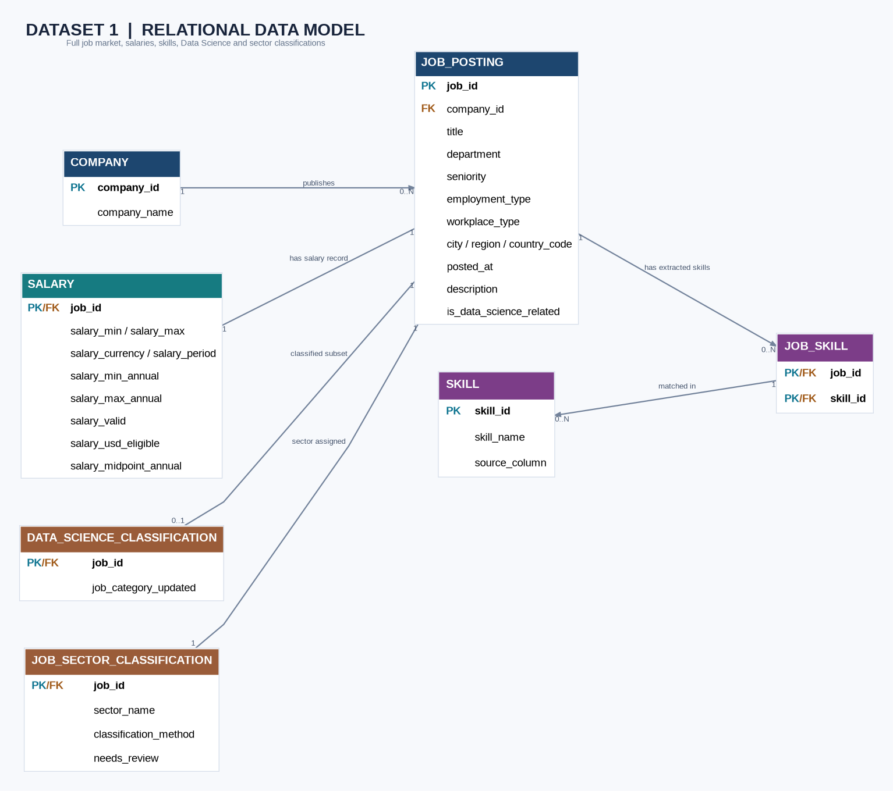

# DATA 607 — Project 3: Data Science Skills and Salaries

## Research question

**Which data science skills are most in demand, and how do those skills relate to salaries?**

This project uses job-posting data to investigate skill demand and advertised compensation for data-related roles. The analysis is performed in R, with a proposed normalized relational model documenting how companies, postings, salaries, and skills relate.

## Dataset 1 overview

| Measure | Result |
| --- | ---: |
| Cleaned job postings | 9,173 |
| Postings included in the revised skill analysis | 226 |
| Individual skills tracked | 30 |
| Detected job–skill associations | 1,142 |
| Jobs with no detected tracked skill | 6 |
| Jobs eligible for the USD salary analysis | 178 |
| Median advertised annual salary midpoint (eligible jobs) | $165,000 |

The 226 postings analyzed for skills are a subset of the 9,173 cleaned postings. Salary summaries should not be interpreted as representing all postings.


## Interactive Data Science Job Market Dashboard

**Live Dashboard:** https://mohdafwan.shinyapps.io/data607-project3/

This dashboard was developed for DATA 607 Project 3 to explore the following research question:

**Which data science skills are most in demand, and how do those skills relate to advertised salaries?**

### Dashboard Features

- **Job Market Overview:** Displays total job postings, jobs with eligible USD salaries, number of skills tracked, and median advertised annual salary.
- **Top Data Science Skills:** Visualizes the ten most frequently requested skills.
- **Job Category Filter:** Allows users to explore skill demand across different data science job categories.
- **Salary Comparison:** Compares median advertised annual salaries across job categories.
- **Interactive Visualizations:** Provides interactive charts with hover information.

### Technology Stack

- **R:** Data cleaning, transformation, analysis, and visualization
- **PostgreSQL:** Relational database containing five normalized tables
- **SQL:** Data retrieval and analysis
- **R Shiny:** Interactive dashboard development
- **ggplot2 and Plotly:** Data visualization
- **shinyapps.io:** Online dashboard hosting
- **GitHub:** Version control and project collaboration

### Dashboard Data

The project database contains 226 selected job postings, 210 companies, 30 tracked skills, and 1,142 job-skill relationships.

The local dashboard connects directly to PostgreSQL. The published dashboard uses summarized CSV files generated from the database, allowing visitors to explore the results without needing database credentials.

Salary comparisons use eligible annual USD advertised salary midpoints. The findings describe the selected dataset and should not be interpreted as representative of the entire data science job market.

### Running the Dashboard Locally

The PostgreSQL-connected dashboard is located in `Dashboard/app.R`.

The standalone version used for online deployment is located in `Dashboard_Online/app.R`.

To run the standalone dashboard in RStudio:

```r
shiny::runApp("Dashboard_Online")
```

**Published Dashboard:** https://mohdafwan.shinyapps.io/data607-project3/


## Selected findings

Among the **226 postings** analyzed for skills:

| Skill | Job postings | Share |
| --- | ---: | ---: |
| Python | 163 | 72.1% |
| SQL | 133 | 58.8% |
| Machine learning | 74 | 32.7% |
| Large language models (LLMs) | 60 | 26.5% |

Skill indicators were extracted from job descriptions using keyword/regular-expression rules. A skill being mentioned in a posting is not proof of proficiency requirements or causal effects on salary. The salary analysis is descriptive rather than causal.

## Entity–relationship (ER) diagram



The diagram is a **proposed relational design**, not a claim that these five tables currently exist as physical database tables.

| Entity | Purpose | Key |
| --- | --- | --- |
| `COMPANY` | Identifies organizations advertising roles | `company_id` (PK) |
| `JOB_POSTING` | Describes each job and links it to a company | `job_id` (PK), `company_id` (FK) |
| `SALARY` | Holds compensation attributes for a posting | `job_id` (PK and FK) |
| `SKILL` | Catalog of the 30 tracked skills | `skill_id` (proposed PK) |
| `JOB_SKILL` | Connects jobs to detected skills | (`job_id`, `skill_id`) composite PK and FKs |

A company can advertise multiple jobs. Each posting has a corresponding salary record in the proposed model. Job postings and skills have a many-to-many relationship, implemented through `JOB_SKILL`; a posting may have no detected skills among the 30 tracked indicators.

The original `jobs_skills_revised.csv` stores the 30 skill indicators as TRUE/FALSE columns. The `JOB_SKILL` entity represents a normalized transformation of these columns. The stored `skill_count` field differs from the sum of the individual indicators for **187 of 226** postings; the ER model therefore uses the individual skill flags to define the **1,142** detected associations. The reason for the discrepancy has not been established.

See [ER diagram documentation](Dataset1_ER_Diagram_Documentation.Rmd) for further detail. The diagram source and reproducible R script are in [`ER_Diagram/`](ER_Diagram/).

## Project files

- `Data/` — project data and derived analysis outputs.
- `01_explore_jobs.R` through `12_validate_results.R`, including the `12B` and `12C` review scripts — data exploration, cleaning, classification, validation, skill extraction, and salary analysis.
- `DATA607_Project3_Dataset1_Documentation.Rmd` — Dataset 1 analysis documentation.
- `Dataset1_ER_Diagram_Documentation.Rmd` — ER diagram documentation.
- `ER_Diagram/Dataset1_ER_Diagram.png` — ER diagram image.
- `ER_Diagram/Dataset1_ER_Diagram.dot` — editable Graphviz source.
- `ER_Diagram/Dataset1_ER_Diagram.R` — R script to render the diagram.
- `ER_Diagram/Dataset1_ER_Diagram.html` — HTML version of the diagram.

## Reproducing the ER diagram

Open the project in RStudio and run the following from the **repository root**:

```r
# Install once if needed:
install.packages(c("DiagrammeR", "DiagrammeRsvg", "rsvg"))

source("ER_Diagram/Dataset1_ER_Diagram.R")
```

The script uses the `.dot` file in the `ER_Diagram/` folder. Consult the script for its exact output behavior and package requirements.

To render the ER documentation in RStudio, open `Dataset1_ER_Diagram_Documentation.Rmd` and knit to HTML, using the project root as the working directory if necessary.

## Limitations

- The job-posting dataset is not necessarily representative of the entire data science labor market.
- The skill analysis uses 226 selected postings, not the entire cleaned dataset.
- Keyword-based extraction may miss skills or identify mentions that are not actual requirements.
- Salary ranges, currencies, and validity flags require filtering before meaningful comparisons.
- Relationships between skill mentions and salary are associations, not evidence that a skill causes higher pay.
- The ER diagram is a proposed normalized structure derived from flat CSV data.

## Repository

[Afwans/DATA607-Project3](https://github.com/Afwans/DATA607-Project3) — working branch: `Afwans-patch-1`.
